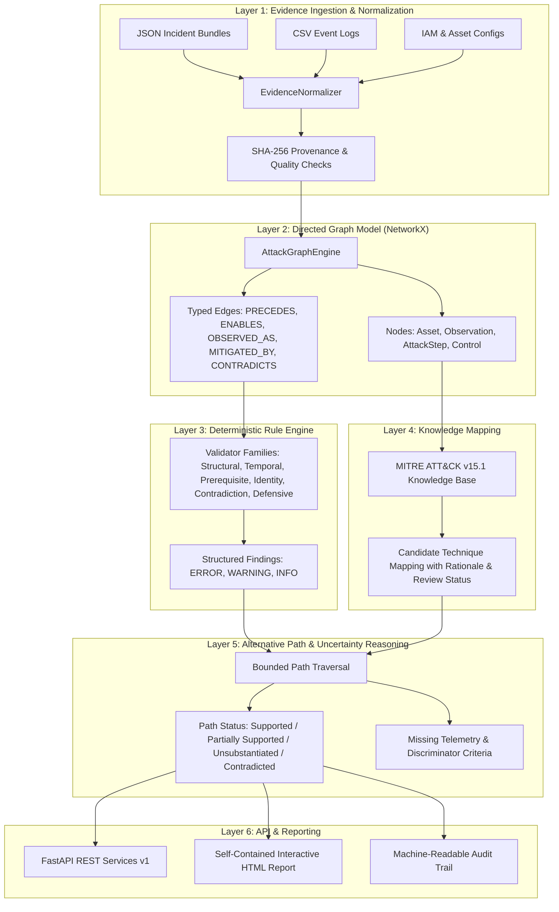

# AttackPath Intelligence — System Architecture

## 1. High-Level Concept

**AttackPath Intelligence** is an evidence-driven cybersecurity analysis platform and attack-chain reasoning engine. Unlike standard visualization tools that merely render theoretical graphs, AttackPath Intelligence:
1. Reconstructs plausible attack chains from heterogeneous security observations (authentication logs, endpoint telemetry, cloud API logs, network flows, and analyst notes).
2. Validates transitions and prerequisites using a deterministic rule engine (`R100–R799`).
3. Explicitly distinguishes verified **Observations** from inferred **Hypotheses**.
4. Preserves the rule that **Temporal Proximity (`PRECEDES`) does not equal Causation (`ENABLES`)**.
5. Surfaces missing telemetry gaps and active evidentiary contradictions (`CONTRADICTS`).
6. Maps supported behaviors to **MITRE ATT&CK** with transparent rationale and analyst-review workflows.
7. Evaluates uncertainty into defensible qualitative states: `SUPPORTED`, `PARTIALLY_SUPPORTED`, `UNSUBSTANTIATED`, and `CONTRADICTED`.

---

## 2. Multi-Layer Reasoning Engine

---

## 3. Data Ontology

### Node Types
- **`Asset`**: A host, identity, application, database, or cloud resource.
- **`Observation`**: Directly verified event with timestamp, category, raw payload, and SHA-256 provenance hash.
- **`AttackStep`**: Proposed action or phase in an attack chain.
- **`Technique`**: MITRE ATT&CK technique reference (e.g., `T1059.001`, `T1003.001`).
- **`SecurityControl`**: Defensive mechanism (preventive, detective, responsive).
- **`Finding`**: Analytical output emitted by deterministic validation rules.

### Edge Semantics
- **`PRECEDES`**: Temporal sequencing ($T_A \le T_B$). No causality implied.
- **`ENABLES`**: Causal prerequisite satisfaction ($A$ satisfies conditions required for $B$).
- **`OBSERVED_AS`**: Attack step directly substantiated by a security observation.
- **`MAPPED_TO`**: Behavior linked to a MITRE technique with documented rationale.
- **`MITIGATED_BY`**: Defensive control capable of neutralizing or detecting a step.
- **`CONTRADICTS`**: Verified evidence directly refutes a claimed step.
- **`DEPENDS_ON`**: Step requires an underlying asset or configuration.
